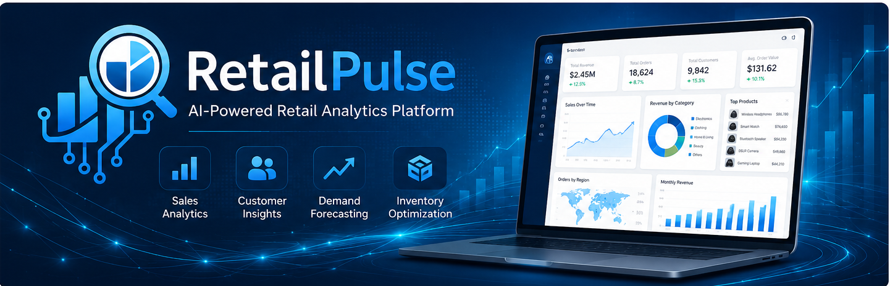
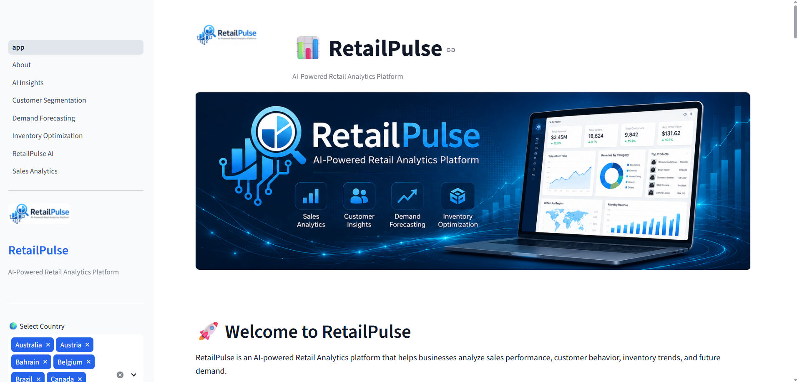
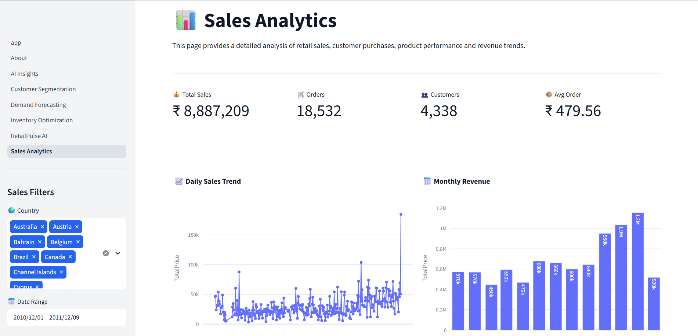
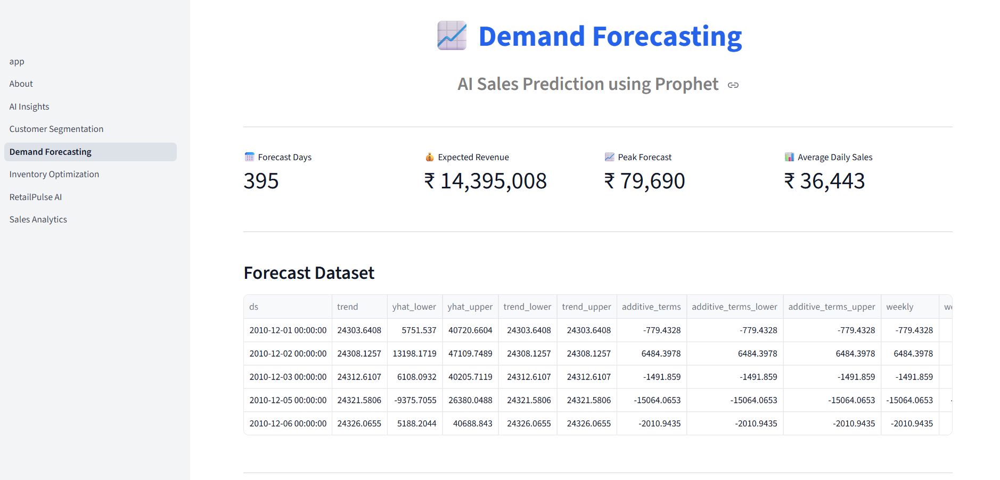
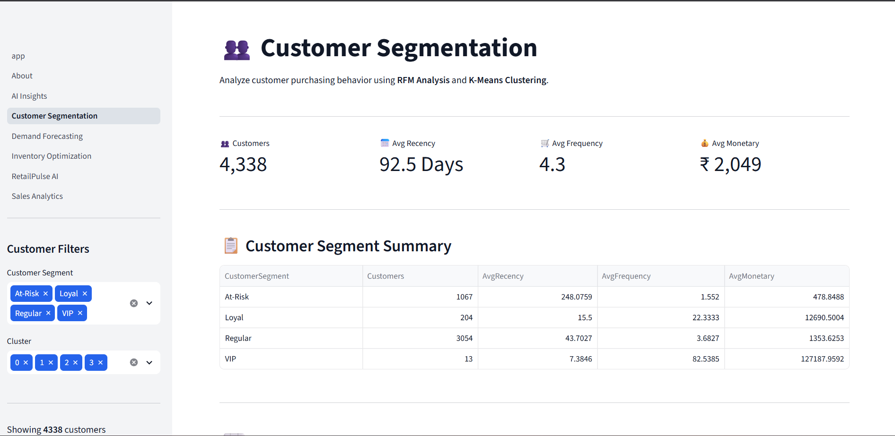
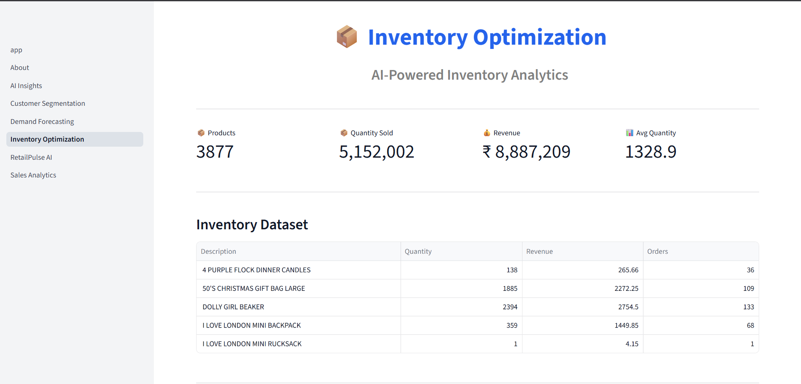
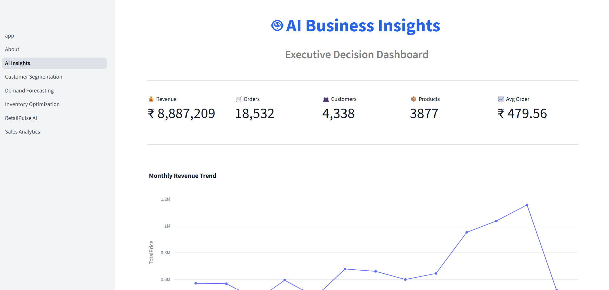

<p align="center">
  
</p>

<h1 align="center">📊 RetailPulse</h1>

<h3 align="center">
AI-Powered Retail Analytics Platform
</h3>

<p align="center">
Built using <b>Python</b>, <b>Streamlit</b>, <b>Machine Learning</b>, <b>Plotly</b>, <b>Prophet</b> and <b>XGBoost</b>
</p>

<p align="center">


</p>

<p align="center">

<a href="https://retailpulseai9670.streamlit.app/">


</a>

<a href="https://github.com/kuldeep2913/RetailPulse">


</a>

</p>

---

# 📌 Overview

RetailPulse is a modern AI-powered Retail Analytics Platform that transforms retail transaction data into actionable business insights through interactive dashboards and Machine Learning.

The application enables businesses to monitor sales performance, understand customer behavior, forecast future demand, optimize inventory, and generate intelligent business recommendations.

RetailPulse combines **Business Intelligence**, **Data Analytics**, **Machine Learning**, and **Interactive Visualization** into one professional web application.

---

# 🌐 Live Demo

### 🚀 Try the Application

**🔗 Live Website**

https://retailpulseai9670.streamlit.app/

---

### 💻 GitHub Repository

https://github.com/kuldeep2913/RetailPulse

---

# ✨ Features

### 📊 Sales Analytics

- KPI Dashboard
- Revenue Analysis
- Daily Sales Trend
- Monthly Revenue
- Top Products
- Country-wise Revenue
- Sales Distribution

---

### 👥 Customer Analytics

- Customer Segmentation
- Customer Leaderboard
- Loyal Customer Analysis
- RFM Analysis
- Customer Purchase Behaviour

---

### 📈 Demand Forecasting

- Future Sales Prediction
- Prophet Forecasting
- Forecast Dataset
- Forecast Charts
- Peak Revenue Prediction

---

### 📦 Inventory Optimization

- Product Performance
- Inventory Insights
- Sales Ranking
- Product Analysis

---

### 🤖 AI Business Intelligence

- AI Recommendations
- Business Health Score
- Executive Summary
- Growth Opportunities
- Business Insights

---


# 🛠 Technology Stack

| Category | Technologies |
|-----------|--------------|
| Language | Python |
| Dashboard | Streamlit |
| Data Analysis | Pandas, NumPy |
| Visualization | Plotly |
| Machine Learning | Scikit-Learn |
| Forecasting | Prophet |
| Prediction | XGBoost |
| Version Control | Git & GitHub |

---

# 📸 Project Screenshots

## 🏠 Home Dashboard



---

## 📊 Sales Analytics



---

## 📈 Demand Forecasting



---

## 👥 Customer Segmentation



---

## 📦 Inventory Optimization



---

## 🤖 AI Business Insights



---
# 📂 Project Structure

```text
RetailPulse/
│
├── app.py
├── requirements.txt
├── README.md
├── LICENSE
├── .gitignore
│
├── assets/
│   ├── banner.png
│   ├── logo.png
│   ├── favicon.png
│   └── style.css
│
├── data/
│   ├── raw/
│   └── processed/
│       ├── cleaned_retail.csv
│       └── sales_forecast.csv
│
├── notebooks/
│   ├── Data_Analysis.ipynb
│   ├── Customer_Segmentation.ipynb
│   ├── Demand_Forecasting.ipynb
│   ├── Inventory_Optimization.ipynb
│   └── Customer_Churn_Prediction.ipynb
│
├── pages/
│   ├── Sales_Analytics.py
│   ├── Customer_Segmentation.py
│   ├── Demand_Forecasting.py
│   ├── Inventory_Optimization.py
│   ├── AI_Insights.py
│
└── screenshots/
    ├── home.png
    ├── sales_dashboard.png
    ├── forecasting.png
    ├── customer_segmentation.png
    ├── inventory.png
    └── ai_insights.png
```

---

# 🚀 Installation

## 1️⃣ Clone the Repository

```bash
git clone https://github.com/kuldeep2913/RetailPulse.git
```

---

## 2️⃣ Navigate to the Project

```bash
cd RetailPulse
```

---

## 3️⃣ Create a Virtual Environment

```bash
python -m venv venv
```

---

## 4️⃣ Activate the Virtual Environment

### Windows

```bash
venv\Scripts\activate
```

### Linux / macOS

```bash
source venv/bin/activate
```

---

## 5️⃣ Install Dependencies

```bash
pip install -r requirements.txt
```

---

## 6️⃣ Run the Application

```bash
streamlit run app.py
```

---

# 📊 Dashboard Modules

- 🏠 Home Dashboard
- 📊 Sales Analytics
- 👥 Customer Segmentation
- 📈 Demand Forecasting
- 📦 Inventory Optimization
- 🤖 AI Business Insights
- 📄 Reports & Downloads

---

# 🤖 Machine Learning Models

RetailPulse integrates Machine Learning techniques to provide intelligent business insights.

### ✔ Customer Segmentation

- RFM Analysis
- Customer Behavior Analysis

### ✔ Demand Forecasting

- Facebook Prophet
- Future Revenue Prediction

### ✔ Business Intelligence

- Executive Summary
- AI Recommendations
- Business Health Score

---

# 📈 Key Features

- Interactive KPI Cards
- Country-wise Revenue Analysis
- Monthly Sales Trends
- Daily Sales Trends
- Customer Insights
- Top Products
- Forecasting Dashboard
- AI Recommendations
- Downloadable Reports
- Beautiful Responsive UI

---

# 📊 Dataset

The project uses the **Online Retail Dataset** containing over **500,000 retail transactions** from a UK-based online retailer.

Dataset includes:

- Invoice Number
- Product Description
- Quantity
- Invoice Date
- Unit Price
- Customer ID
- Country

---

# 🎯 Future Improvements

- User Authentication
- Dark/Light Theme Toggle
- PDF Report Generation
- Email Reports
- REST API Integration
- Real-Time Database
- AI Chat Assistant
- Docker Support
- Cloud Deployment
- Mobile Responsive Dashboard

---

# 👨‍💻 Developer

## Kuldeep Yadav

**B.Tech – Computer Science Engineering (AI)**

Shivalik College of Engineering

### GitHub

https://github.com/kuldeep2913

---

# 🤝 Contributing

Contributions are welcome!

If you'd like to improve RetailPulse:

1. Fork the repository
2. Create a feature branch
3. Commit your changes
4. Push the branch
5. Open a Pull Request

---

# ⭐ Support

If you found this project useful,

⭐ Please **Star** this repository on GitHub.

It motivates me to build more open-source AI and Data Science projects.

---

# 📜 License

This project is licensed under the **MIT License**.

See the **LICENSE** file for details.

---

<p align="center">

Made with ❤️ by <b>Kuldeep Yadav</b>

</p>
## Frontend structure (redesign)

```
app.py                 router: st.navigation(position="top"), theme
views/                 one file per page (Overview, Sales, Customers, Forecast, Inventory, AI Insights)
core/                  config (palette, currency, team) and cached data layer + rule-based insights
ui/                    theme, components, charts, filters
assets/style.css       centralised stylesheet
```
Run with `streamlit run app.py` (requires Streamlit 1.50 or newer).


## UI design (v2)

The interface follows the RetailPulse dashboard design: warm grey canvas, pill navigation, dark / lime / lavender
KPI cards and Plus Jakarta Sans typography.

- `assets/style.css` holds every design token and the responsive rules (3 breakpoints: 1024px, 640px, 380px).
- `core/config.py` holds the chart palette (`COLORS`, `SEGMENT_COLORS`, `ABC_COLORS`); keep it in sync with the CSS tokens.
- `ui/components.py` has the card builders, including the Overview hero cards (`hero_revenue`, `hero_aov`,
  `hero_customers`, `forecast_card`); `ui/charts.py` has `trend_forecast`, the revenue trend with the 90-day forecast.
- Filters (period, custom dates, country, segment, cluster) and all calculations in `core/` are unchanged.

Run with `pip install -r requirements.txt` then `streamlit run app.py`.
